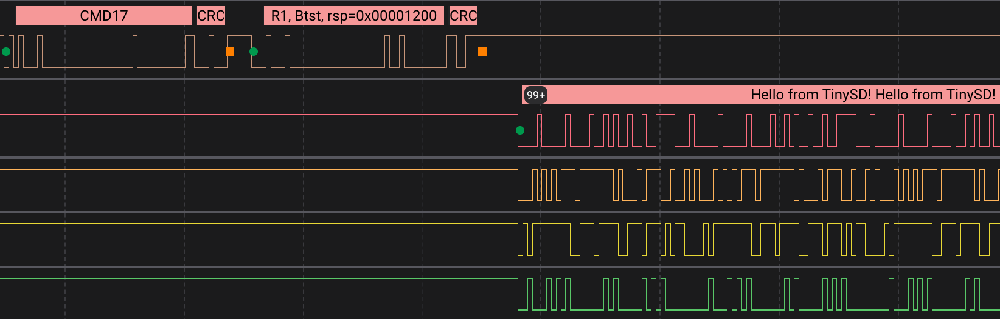

<h1 align="center">
  
  TinySD
</h1>

Dependency-free C library for SD cards and SDIO on embedded and bare-metal systems.



## Features

- C implementation, no external dependencies
- No dynamic allocation, all state in caller-owned structs
- SD memory card driver (SDSC, SDHC and SDXC) with high speed support
- SDIO card driver with byte and block transfers, card interrupts, and high speed support
- SDHCI host driver for SD Host Controller versions 1 to 3
- SPI host driver for SD memory cards on any SPI peripheral
- Simple interface for adding your own SD hosts
- CRC and framing helpers for software hosts (bit-banged, PIO, etc)
- Polling API, no threads, callbacks or interrupts

## Installation

Copy `tinysd` into your project, or add it as a git submodule.

If you are using CMake:

```cmake
# Add the library directory
add_subdirectory(tinysd)

# Link the targets you need, or tinysd for everything, eg:
target_link_libraries(my_app tinysd_card tinysd_sdhci)
```

Otherwise, add `include/` to your include path and compile what you need from `src/`.

## Usage

### Required Functions

Your application must provide `tsd_delay_us`, which TinySD uses to wait on the card, such as while it powers up.

```c
#include <tinysd.h>

void tsd_delay_us(uint32_t microseconds)
{
  // Spin or sleep for at least microseconds
}
```

### Initializing a Host

A host drives the SD bus, and the card drivers talk to it through `struct tsd_host`. TinySD has built-in hosts for SDHCI controllers and SPI buses, or you can write your own.

For example, if using the built-in SDHCI host controller:

```c
static struct tsd_sdhci sdhci;

// Start the host controller, moving data through its FIFO
struct tsd_sdhci_config config = {.base = SDHCI_BASE};
int ret = tsd_sdhci_init(&sdhci, config);

// Pass this to the card drivers
struct tsd_host *host = TSD_HOST(&sdhci);
```

See [Hosts](#hosts) for how to set up each built-in host, and how to write your own.

### Using SD Memory Cards

Bring the card up on 1 or 4 data lines, at the highest clock you want in kHz, such as 50000 for 50 MHz. A card without high speed runs at 25 MHz instead. An SPI host has one data line, so pass 1.

```c
static struct tsd_card card;
static uint32_t buffer[TSD_CARD_BLOCK_SIZE / 4];

// Bring the card up on four data lines at up to 50 MHz
int ret = tsd_card_init(&card, host, 4, 50000);

// Read block 0, change it and write it back
ret = tsd_card_read(&card, buffer, 0, 1);
ret = tsd_card_write(&card, buffer, 0, 1);

// End any open read, such as before powering down
ret = tsd_card_sync(&card);
```

#### Bring Your Own Filesystem

TinySD reads and writes raw blocks, so it is usually paired with a filesystem such as ChaN's [FatFs](https://elm-chan.org/fsw/ff/), [littlefs](https://github.com/littlefs-project/littlefs), etc.

For example, when using FatFs:

| FatFs                              | TinySD                |
| ---------------------------------- | --------------------- |
| `disk_initialize`                  | `tsd_card_init`       |
| `disk_read`                        | `tsd_card_read`       |
| `disk_write`                       | `tsd_card_write`      |
| `CTRL_SYNC` in `disk_ioctl`        | `tsd_card_sync`       |
| `CTRL_TRIM` in `disk_ioctl`        | `tsd_card_erase`      |
| `GET_SECTOR_SIZE` in `disk_ioctl`  | `TSD_CARD_BLOCK_SIZE` |
| `GET_SECTOR_COUNT` in `disk_ioctl` | `card.blocks`         |

### Using SDIO Devices

Bring the card up, then enable the function your device uses and set its block size.

```c
static struct tsd_sdio sdio;
static uint32_t buffer[64];

// Bring the card up on four data lines at up to 50 MHz
int ret = tsd_sdio_init(&sdio, host, 4, 50000);

// Enable function 1 with 64-byte blocks
ret = tsd_sdio_enable_function(&sdio, 1);
ret = tsd_sdio_set_block_size(&sdio, 1, 64);

// Read one register, then a run of bytes
uint8_t value;
ret = tsd_sdio_read_byte(&sdio, 1, 0x00, &value);
ret = tsd_sdio_transfer(&sdio, 1, 0x100, false, buffer, sizeof(buffer), 64, NULL);
```

After init, the ids from the card's CIS are in `sdio.cis`. To read them without bringing the card up, call `tsd_sdio_identify`, which fills in a `struct tsd_sdio_cis` and leaves the card for another driver.

## Hosts

### SDHCI

The SDHCI host drives an SD Host Controller, versions 1 to 3, through its registers.

```c
static struct tsd_sdhci sdhci;

struct tsd_sdhci_config config = {
  // Register base address, as the CPU sees it
  .base = SDHCI_BASE,

  // Map buffers for DMA, or leave these NULL to move data through the FIFO
  .dma_map   = my_dma_map,
  .dma_unmap = my_dma_unmap,
};
int ret = tsd_sdhci_init(&sdhci, config);
```

### SPI

The SPI host runs a memory card in SPI mode, through four functions you provide. SDIO is not supported on SPI hosts.

```c
static struct tsd_spi spi;

struct tsd_spi_config config = {
  // Send bytes and ignore what comes back
  .write = my_spi_write,

  // Receive bytes while sending 0xff
  .read = my_spi_read,

  // Drive chip select low to select the card, or high to release it
  .select = my_spi_select,

  // Run the clock at the highest rate at or below a limit in kHz
  .set_clock = my_spi_set_clock,
};

// Start the host, which clocks the card awake at 400 kHz
int ret = tsd_spi_init(&spi, config);
```

For wiring, see ChaN's excellent [How to Use MMC/SDC](https://elm-chan.org/docs/mmc/mmc_e.html) guide to SD cards in SPI mode. It covers the pinout, the pull-ups and the power a card needs.

### Your Own Host

For systems without an SDHCI controller or an SPI peripheral, you can write your own host, such as one that bit-bangs the bus or drives it with PIO. Hosts like these can build and check frames with `frame.h` and `crc.h`.

Make a struct that embeds `struct tsd_host` as its first field, and point it at a table of your host's operations.

```c
struct my_host {
  struct tsd_host base;
};

static const struct tsd_host_api my_api = {
  .request       = my_request,
  .set_clock     = my_set_clock,
  .set_bus_width = my_set_bus_width,
  .card_busy     = my_card_busy,
};

static struct my_host my_host = {.base.api = &my_api};
```

Then pass `TSD_HOST(&my_host)` to the card drivers.

## Running from RAM

To speed up transfers, or to keep them running while flash is unavailable, place `card_io.c`, `sdio_io.c`, `frame.c` and `crc.c` in RAM from your linker script, along with their read-only data. Everything they call must be in RAM too, including your host's operations, `tsd_delay_us` and compiler helpers such as `memcpy`.

## License

This project is licensed under the MIT License. See the [LICENSE](LICENSE) file for details.
